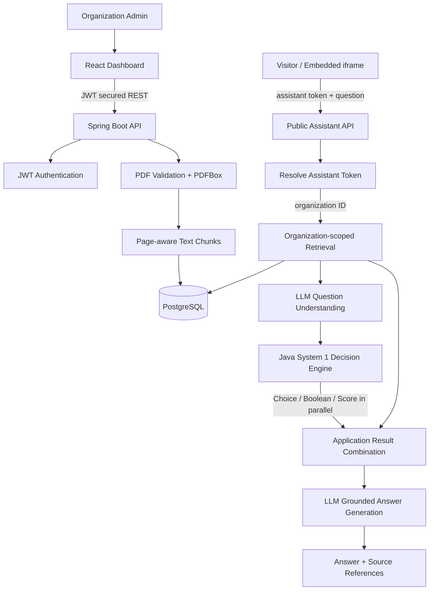

# Knowwise — AI Knowledge & Decision Assistant

A multi-tenant SaaS MVP that turns an organization's private PDF documents into a public, source-grounded AI assistant. The project is built with Java 17, Spring Boot, PostgreSQL, React and a deterministic System 1 decision engine.

> **Assignment alignment:** Organization registration/login, isolated PDF knowledge bases, 10-file/20-page/10-MB upload limits, secure assistant URLs, public visitor chat, iframe embed code, retrieval with document/page references, LLM question understanding and answer generation, structured Choice/Boolean/Score decisions, test data, README and CI are included.

## Features

- Organization registration and login with BCrypt password hashing and JWT authentication.
- Tenant-aware entities and repository queries. Each document chunk is associated with exactly one organization.
- PDF validation: PDF signature, `.pdf` extension, 10 MB maximum, 20 pages maximum and 10 documents per organization.
- Apache PDFBox page-by-page extraction and page-aware text chunking.
- Keyword retrieval scoped to the assistant token's organization; source references include filename and page.
- Optional OpenAI Chat Completions integration for question classification/decomposition and grounded answer generation.
- Independent Java System 1 decisions (Choice, Boolean eligibility and evidence-coverage Score), executed concurrently and combined by application logic.
- Public assistant token, visitor chat page and iframe embed snippet.
- Dashboard for document upload/list/delete, assistant URL/token rotation, embed code and usage counts.
- Docker Compose for PostgreSQL, Spring Boot and Nginx-served React frontend.
- Sample PDFs for two independent organizations and a 12-question test set.

## Architecture



### Question processing flow

1. A visitor submits a question and the public assistant token.
2. The backend validates the token and resolves its organization.
3. Retrieval loads only chunks whose `organization_id` matches that organization.
4. The LLM (when `OPENAI_API_KEY` is configured) classifies the question and extracts user-stated fields. It does not decide eligibility.
5. For decision questions, the Java decision engine independently evaluates:
   - **Choice:** policy category (merit, sports, need-based or general).
   - **Boolean:** explicit eligibility criteria found in the retrieved policy text (for example GPA, year and other-scholarship restrictions).
   - **Score:** a transparent evidence-coverage score, not a probability of approval.
6. `CompletableFuture` runs the structured decision tasks concurrently. Application logic combines their results.
7. The LLM writes a concise answer using only retrieved passages and structured results. If no API key is configured or the LLM call fails, the application uses a safe deterministic fallback.
8. The response includes the source filename and page for each retrieved passage. If retrieval finds no relevant content, the assistant says the knowledge base does not contain enough information.

The implementation does not expose private chain-of-thought. The API returns short, auditable decision rationales and source references.

## Requirements

- Java 17+
- Maven 3.9+
- Node.js 20+ and npm
- PostgreSQL 14+ (or Docker Desktop with Docker Compose)
- OpenAI API key for LLM-based question decomposition and answer generation (optional for local deterministic fallback)

## Quick start with Docker Compose

1. Copy the environment template:

   ```bash
   cp .env.example .env
   ```

2. Generate a strong Base64 JWT key and put it in `.env`:

   ```bash
   openssl rand -base64 48
   ```

   Set `JWT_SECRET` to the generated value. Set `OPENAI_API_KEY` if you want the OpenAI-powered path. Do not commit `.env`.

3. Start the application:

   ```bash
   docker compose up --build
   ```

4. Open the dashboard at <http://localhost:5173>.
5. The backend health endpoint is <http://localhost:8080/api/health>.

The Compose stack starts PostgreSQL, the Spring Boot API and the React application served by Nginx. Uploaded files and PostgreSQL data are stored in named Docker volumes.

## Run locally without Docker

### 1. PostgreSQL

Create the database:

```sql
CREATE DATABASE ai_knowledge_assistant;
```

Set the following environment variables before starting Spring Boot:

```bash
export DB_URL=jdbc:postgresql://localhost:5432/ai_knowledge_assistant
export DB_USERNAME=postgres
export DB_PASSWORD=your-local-password
export JWT_SECRET="$(openssl rand -base64 48)"
export PUBLIC_BASE_URL=http://localhost:5173
export OPENAI_API_KEY=your-openai-api-key # optional
```

### 2. Backend

```bash
cd backend
mvn spring-boot:run
```

The API runs at <http://localhost:8080>. The Vite development server proxies `/api` requests to this port.

### 3. Frontend

In another terminal:

```bash
cd frontend
npm install
npm run dev
```

Open <http://localhost:5173>.

## First-use walkthrough

1. Register an organization from the dashboard. The first account becomes that organization's `ORG_ADMIN`.
2. Upload PDFs. The dashboard enforces the assignment's document count, page count and file-size limits.
3. The backend extracts each PDF page and stores text chunks with organization, document and page metadata.
4. The dashboard displays the unique public assistant URL and iframe snippet.
5. Open the URL in a private/incognito window (no admin login is required) or paste the iframe snippet into an external HTML page.
6. Ask a question that appears in the uploaded PDFs. The answer includes filename/page references.
7. Ask an unrelated question. The assistant should say the knowledge base does not contain enough information.

## Two-organization isolation demonstration

The `sample-data` directory contains separate sample PDFs:

- `sample-data/org-a/Scholarship_Rules.pdf`
- `sample-data/org-a/Academic_Policy.pdf`
- `sample-data/org-b/Financial_Aid_Guidelines.pdf`
- `sample-data/org-b/Student_Handbook.pdf`

To demonstrate isolation:

1. Register **ABC University** and upload only the two `org-a` PDFs.
2. Register **Northstar College** using a different email and upload only the two `org-b` PDFs.
3. Ask ABC University's assistant about its Merit Scholarship GPA threshold. It should retrieve `Scholarship_Rules.pdf`.
4. Ask Northstar College's assistant the same question. It should not return ABC University's policy; if Northstar's PDFs do not contain the answer, it should say so.
5. Ask Northstar's assistant about library hours. It should cite `Student_Handbook.pdf`.

The isolation boundary is enforced in the backend: the assistant token resolves to an organization ID, and the retrieval query only loads chunks for that organization. Admin document APIs derive the organization ID from the authenticated JWT principal; clients cannot supply another tenant ID.

## API endpoints

### Public

| Method | Endpoint | Purpose |
|---|---|---|
| `GET` | `/api/health` | Health check |
| `GET` | `/api/public/assistant/{token}` | Public assistant display metadata |
| `POST` | `/api/public/ask` | Ask a question using an assistant token |

Example request:

```json
{
  "assistantToken": "paste-the-token-from-your-dashboard",
  "question": "What is the minimum GPA for the Merit Scholarship?"
}
```

### Authentication

| Method | Endpoint | Purpose |
|---|---|---|
| `POST` | `/api/auth/register` | Create organization and admin |
| `POST` | `/api/auth/login` | Authenticate and return JWT |
| `GET` | `/api/auth/me` | Current authenticated user |

Registration body:

```json
{
  "organizationName": "ABC University",
  "fullName": "Admin User",
  "email": "admin@example.com",
  "password": "StrongPass123"
}
```

### Authenticated organization admin

Send `Authorization: Bearer <accessToken>`.

| Method | Endpoint | Purpose |
|---|---|---|
| `GET` | `/api/documents` | List this organization's PDFs |
| `POST` | `/api/documents` | Upload a PDF (`multipart/form-data`, field `file`) |
| `DELETE` | `/api/documents/{id}` | Delete a PDF and its chunks |
| `GET` | `/api/organization/assistant` | Get assistant URL and iframe snippet |
| `POST` | `/api/organization/assistant/regenerate` | Rotate public assistant token |
| `GET` | `/api/organization/usage` | Usage counts |

## Test questions

See [`docs/test-questions.md`](docs/test-questions.md) for 12 questions covering direct lookup, policy, procedure, comparison, multiple structured decisions and missing knowledge-base information.

Backend unit tests cover a multi-condition scholarship evaluation and the insufficient-policy case:

```bash
cd backend
mvn test
```

Frontend production build:

```bash
cd frontend
npm install
npm run build
```

## Security and privacy notes

- Passwords are stored using BCrypt.
- Admin endpoints require a valid signed JWT.
- JWTs contain the user ID, organization ID and role.
- Assistant tokens are random UUIDs and only authorize the public assistant endpoints.
- Private PDF bytes are stored outside the public web root and are never exposed through a public download endpoint.
- Document metadata and chunks are always scoped by organization ID.
- File uploads are validated by extension, content type when provided, PDF magic bytes, size and page count.
- Secrets are provided through environment variables. `.env` is ignored by Git.

## Known limitations and production improvements

This is an assignment MVP, not a production-ready enterprise platform.

- Retrieval uses transparent keyword overlap rather than embeddings/vector search. A production version could add pgvector embeddings and hybrid reranking.
- Eligibility rules are extracted from the retrieved text using conservative patterns. For arbitrary policy documents, a reviewed rule-authoring UI or schema-based policy extraction is needed. If criteria are missing or user facts are incomplete, the decision engine returns `INSUFFICIENT_POLICY` or `INSUFFICIENT_DATA` instead of guessing.
- OpenAI integration uses a configurable chat-completions model. Add rate limits, retries, request tracing, prompt-injection hardening and provider abstraction before production.
- Local filesystem storage is used for uploaded PDFs. Production should use private object storage, malware scanning, retention policies and encrypted backups.
- Add email verification, password reset, refresh-token rotation, audit logs, rate limiting, CSRF strategy for cookie auth and organization member/role management for a production SaaS.
- Usage metrics are basic organization-level counters.

## Repository layout

```text
backend/       Spring Boot API, persistence, PDF processing, retrieval and decision engine
frontend/      React + Vite dashboard and public chat widget
sample-data/   Four sample PDFs for two separate organizations
docs/          Test questions and demo walkthrough
.github/       CI workflow
```

## Demo video checklist (8–15 minutes)

- Show registration/login and dashboard.
- Upload and manage the sample PDFs.
- Show assistant URL and iframe embed code; open the public assistant without admin login.
- Ask a direct question and show filename/page sources.
- Ask a multi-condition scholarship question and explain Choice, Boolean and Score decisions.
- Ask an unsupported question and show the grounded fallback.
- Switch to the second organization and demonstrate that the first organization's policy is not retrieved.
- Explain the architecture and the tenant-scoped retrieval flow without revealing private chain-of-thought.
